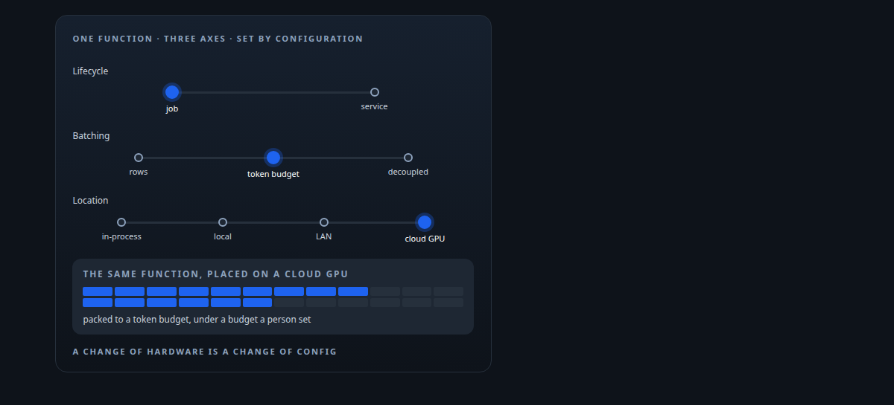
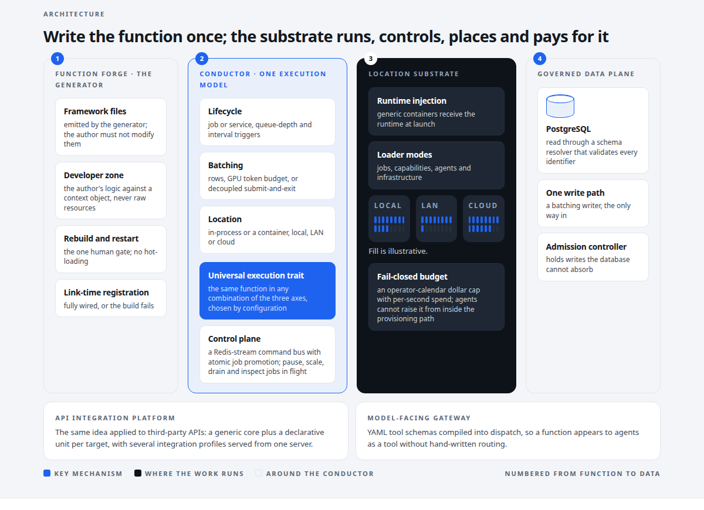
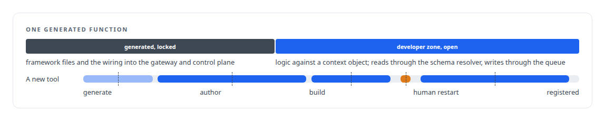
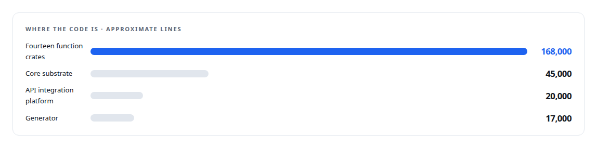
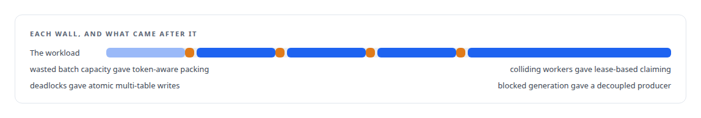

# FAFO Core and Function Forge

**The execution substrate under everything else: one function definition becomes an orchestrated, budgeted, agent-callable tool**

Canonical: https://coreyjames.ai/systems/fafo-core/  
Author: Corey James · Published: 2026-10-28 · Kind: system  
DOI: https://doi.org/10.5281/zenodo.23735130  
Technologies: [Admission control and rate limiting](https://github.com/coreyjames-ai/portfolio/tree/main/technologies/admission-control-and-rate-limiting) · [Axum](https://github.com/coreyjames-ai/portfolio/tree/main/technologies/axum) · [Bash](https://github.com/coreyjames-ai/portfolio/tree/main/technologies/bash) · [Binary wire protocol design](https://github.com/coreyjames-ai/portfolio/tree/main/technologies/binary-wire-protocol-design) · [Budget enforcement and cost governance](https://github.com/coreyjames-ai/portfolio/tree/main/technologies/budget-enforcement-and-cost-governance) · [Cache synchronisation and leader election](https://github.com/coreyjames-ai/portfolio/tree/main/technologies/cache-synchronisation-and-leader-election) · [Code generation and metaprogramming](https://github.com/coreyjames-ai/portfolio/tree/main/technologies/code-generation-and-metaprogramming) · [Database performance diagnosis](https://github.com/coreyjames-ai/portfolio/tree/main/technologies/database-performance-diagnosis) · [Distributed job orchestration](https://github.com/coreyjames-ai/portfolio/tree/main/technologies/distributed-job-orchestration) · [Docker](https://github.com/coreyjames-ai/portfolio/tree/main/technologies/docker) · [Evidence-gated API integration](https://github.com/coreyjames-ai/portfolio/tree/main/technologies/evidence-gated-api-integration) · [Evidence-gated acceptance](https://github.com/coreyjames-ai/portfolio/tree/main/technologies/evidence-gated-acceptance) · [FastAPI](https://github.com/coreyjames-ai/portfolio/tree/main/technologies/fastapi) · [Federated compute provisioning](https://github.com/coreyjames-ai/portfolio/tree/main/technologies/federated-compute-provisioning) · [Governed AI-assisted software engineering](https://github.com/coreyjames-ai/portfolio/tree/main/technologies/governed-ai-assisted-software-engineering) · [Grafana](https://github.com/coreyjames-ai/portfolio/tree/main/technologies/grafana) · [GraphQL](https://github.com/coreyjames-ai/portfolio/tree/main/technologies/graphql) · [Handlebars](https://github.com/coreyjames-ai/portfolio/tree/main/technologies/handlebars) · [JSON Schema](https://github.com/coreyjames-ai/portfolio/tree/main/technologies/json-schema) · [JSON Web Token (JWT)](https://github.com/coreyjames-ai/portfolio/tree/main/technologies/json-web-token-jwt) · [JSON-RPC](https://github.com/coreyjames-ai/portfolio/tree/main/technologies/json-rpc) · [Large-scale GPU data pipelines](https://github.com/coreyjames-ai/portfolio/tree/main/technologies/large-scale-gpu-data-pipelines) · [Lease-based work claiming](https://github.com/coreyjames-ai/portfolio/tree/main/technologies/lease-based-work-claiming) · [Link-time plugin registration](https://github.com/coreyjames-ai/portfolio/tree/main/technologies/link-time-plugin-registration) · [Lua](https://github.com/coreyjames-ai/portfolio/tree/main/technologies/lua) · [MessagePack](https://github.com/coreyjames-ai/portfolio/tree/main/technologies/messagepack) · [Model Context Protocol (MCP)](https://github.com/coreyjames-ai/portfolio/tree/main/technologies/model-context-protocol-mcp) · [Multilingual embedding model](https://github.com/coreyjames-ai/portfolio/tree/main/technologies/multilingual-embedding-model) · [NVIDIA Blackwell GPUs](https://github.com/coreyjames-ai/portfolio/tree/main/technologies/nvidia-blackwell-gpus) · [NVIDIA TensorRT-LLM](https://github.com/coreyjames-ai/portfolio/tree/main/technologies/nvidia-tensorrt-llm) · [OAuth 2.0](https://github.com/coreyjames-ai/portfolio/tree/main/technologies/oauth-2-0) · [OpenAPI](https://github.com/coreyjames-ai/portfolio/tree/main/technologies/openapi) · [Performance engineering and benchmarking](https://github.com/coreyjames-ai/portfolio/tree/main/technologies/performance-engineering-and-benchmarking) · [PostgreSQL](https://github.com/coreyjames-ai/portfolio/tree/main/technologies/postgresql) · [PostgreSQL bulk-update engineering](https://github.com/coreyjames-ai/portfolio/tree/main/technologies/postgresql-bulk-update-engineering) · [Prometheus](https://github.com/coreyjames-ai/portfolio/tree/main/technologies/prometheus) · [PyO3](https://github.com/coreyjames-ai/portfolio/tree/main/technologies/pyo3) · [Python](https://github.com/coreyjames-ai/portfolio/tree/main/technologies/python) · [Redis](https://github.com/coreyjames-ai/portfolio/tree/main/technologies/redis) · [Reversible infrastructure mutation](https://github.com/coreyjames-ai/portfolio/tree/main/technologies/reversible-infrastructure-mutation) · [RunPod](https://github.com/coreyjames-ai/portfolio/tree/main/technologies/runpod) · [Rust](https://github.com/coreyjames-ai/portfolio/tree/main/technologies/rust) · [SQL](https://github.com/coreyjames-ai/portfolio/tree/main/technologies/sql) · [Schema-agnostic data access and SQL-injection defence](https://github.com/coreyjames-ai/portfolio/tree/main/technologies/schema-agnostic-data-access-and-sql-injection-defence) · [Schema-driven build-time code generation](https://github.com/coreyjames-ai/portfolio/tree/main/technologies/schema-driven-build-time-code-generation) · [Synthetic training-data generation](https://github.com/coreyjames-ai/portfolio/tree/main/technologies/synthetic-training-data-generation) · [TLS and mTLS](https://github.com/coreyjames-ai/portfolio/tree/main/technologies/tls-and-mtls) · [Text embedding models](https://github.com/coreyjames-ai/portfolio/tree/main/technologies/text-embedding-models) · [Token-aware GPU batch scheduling](https://github.com/coreyjames-ai/portfolio/tree/main/technologies/token-aware-gpu-batch-scheduling) · [Tokio](https://github.com/coreyjames-ai/portfolio/tree/main/technologies/tokio) · [Webhook ingestion and verification](https://github.com/coreyjames-ai/portfolio/tree/main/technologies/webhook-ingestion-and-verification) · [Write-behind persistence](https://github.com/coreyjames-ai/portfolio/tree/main/technologies/write-behind-persistence) · [YAML](https://github.com/coreyjames-ai/portfolio/tree/main/technologies/yaml) · [pgvector](https://github.com/coreyjames-ai/portfolio/tree/main/technologies/pgvector) · [ratatui](https://github.com/coreyjames-ai/portfolio/tree/main/technologies/ratatui) · [sqlx](https://github.com/coreyjames-ai/portfolio/tree/main/technologies/sqlx)  
Skills: [tool synthesis and governed API integration](https://github.com/coreyjames-ai/portfolio/tree/main/skills/tool-synthesis-and-governed-api-integration) · [Rust systems engineering](https://github.com/coreyjames-ai/portfolio/tree/main/skills/rust-systems-engineering) · [agent orchestration](https://github.com/coreyjames-ai/portfolio/tree/main/skills/agent-orchestration) · [evidence-gated acceptance](https://github.com/coreyjames-ai/portfolio/tree/main/skills/evidence-gated-acceptance)  



## Result

| Figure | What it measures |
| --- | --- |
| **7 of 14** | function crates written by the generator |
| **19** | control actions on a job in flight |
| **180** | actions across 18 tools, compiled from YAML schemas |
| **23** | close items on the integration platform, each with an independent verdict |



## What was built

Every organisation that puts AI agents to work hits the same wall. Each new capability needs its own integration, orchestration, database plumbing, rate limiting, compute and someone to run it. I was going to build many systems and I did not want to solve orchestration, data safety and spend control more than once. FAFO Core is the substrate where those are solved. One function definition becomes an orchestrated, controllable, agent-callable tool that runs against any registered data source, in-process or in a container on a local machine, a LAN workstation or a rented cloud GPU, under a budget a human set. Function Forge is the generator that lets an agent write such a function itself, inside a sandbox, callable only after a human rebuild and restart.

## The idea

One execution model, three orthogonal axes. Lifecycle: a one-off job or a continuous service, with queue-depth and interval triggers. Batching: by row count, by GPU token budget, or decoupled submit-and-exit, with memory-budget packing. Location: in-process or in a container, local, LAN or cloud. The same function runs in any combination by configuration, so a change of hardware is a change of config.

AI agents are bounded authors. The generator emits framework files the author must not modify and a developer zone where the author writes logic against a context object, never against raw resources. Reads go through a schema resolver that validates every identifier. Writes go only through the governed queue. The human gate sits exactly at the privileged step, the rebuild and restart, and nowhere else. See [Tools that build tools, under governance](https://coreyjames.ai/stories/tools-that-build-tools-under-governance).



## What I built

The universal execution trait and the generic conductor that runs it across lifecycle, batching and location.

The function lifecycle: design, generate, wire, author, validate, build, human restart, link-time registration, execute, control, delete. Registration at link time means a function is fully wired or the build fails; there is no half-registered state.

A control plane on a Redis-stream command bus with atomic job promotion and control of jobs in flight: pause, scale, drain, inspect.

A governed data plane: a single governed write path with a batching writer, schema-agnostic database operations validated through a schema resolver, and an admission controller. The writer and the admission controller are trade secrets.

A location substrate: runtime injection into generic containers; local, LAN and cloud GPU providers; loader modes for jobs, capabilities, agents and infrastructure; a fail-closed operator-calendar budget with per-second spend accounting that agents cannot raise from inside the provisioning path. Cloud GPU bursting sits under that gate.

A sibling API integration platform that applies the same idea to third-party APIs, a generic core plus a declarative unit per target, serving multiple integration profiles per server. I built it through gated AI work orders and held it open until every close item had an independent verdict. See [Closed by evidence](https://coreyjames.ai/stories/closed-by-evidence).

A model-facing gateway that compiles YAML tool schemas into dispatch.

The probe-generation pipeline, the workload that shaped all of this, which populated tens of millions of dataset items on two consumer GPUs. See [The workload that shaped the platform](https://coreyjames.ai/stories/the-workload-that-shaped-the-platform).



## The judgment in it

I let the real workload drive the substrate. Nothing speculative went in.



The first version of the generator passed its own fifteen-point integration check and produced code that did not compile. I redesigned it with the sandbox and inverted ownership instead of patching it.

No hot-loading.


When a bulk write path crawled with 196 deadlocks, I measured from PostgreSQL's own tuple statistics instead of the queue's counters, and one index took it to zero. See [196 deadlocks to zero](https://coreyjames.ai/stories/196-deadlocks-to-zero).

## What it demonstrates

Solving the platform problem once so every later system inherits orchestration, data safety and spend control; security by API design for AI-generated code; and the discipline to throw away a first version that passed its own tests.

## Stories

[Tools that build tools, under governance](https://coreyjames.ai/stories/tools-that-build-tools-under-governance) · [196 deadlocks to zero](https://coreyjames.ai/stories/196-deadlocks-to-zero) · [The workload that shaped the platform](https://coreyjames.ai/stories/the-workload-that-shaped-the-platform) · [Closed by evidence](https://coreyjames.ai/stories/closed-by-evidence) · [Redistribution inside the database](https://coreyjames.ai/stories/redistribution-inside-the-database) · [One call to a GPU anywhere](https://coreyjames.ai/stories/one-call-to-a-gpu-anywhere) · [Twenty thousand rows a second](https://coreyjames.ai/stories/twenty-thousand-rows-a-second) · [A write path that sizes itself](https://coreyjames.ai/stories/a-write-path-that-sizes-itself) · [Rules that never ran](https://coreyjames.ai/stories/rules-that-never-ran) · [Pricing writes by what they cost the database](https://coreyjames.ai/stories/pricing-writes-by-what-they-cost)

## Technologies

Rust · Redis Streams · PostgreSQL write-behind patterns · Handlebars code generation · Link-time registration · Docker · Federated provisioning across local, LAN and cloud · Budget enforcement · YAML schema compilation · Model Context Protocol · PostgreSQL bulk-update engineering

> Rebuild and human restart is slower, and it is the governance step.

## What was verified

Each line is a claim the canonical page supports, with the figure as the page states it.

- Platform engineering for AI agents: one function definition becomes an orchestrated, budgeted, agent-callable tool, in-process or in a container, local, LAN or cloud, by configuration alone.
- Tool synthesis and governed API integration: a generator that let agents write 7 of 14 function crates in a sandbox, callable only after a human rebuild and restart.
- Job control planes: a Redis-stream command bus with atomic job promotion and 19 control actions on a job in flight, including pause, scale, drain and inspect.
- MCP server design: a model-facing gateway compiling YAML schemas into 180 actions across 18 tools.
- Rust systems engineering: about 168,000 lines across fourteen function crates and 45,000 in the core substrate, with link-time registration so nothing runs half-wired.
- Evidence-gated acceptance: a sibling API integration platform held open until all 23 close items had an independent verdict.

## Related

- [Tools that build tools, under governance](https://github.com/coreyjames-ai/fafo-core/tree/main/stories/tools-that-build-tools-under-governance) · https://coreyjames.ai/stories/tools-that-build-tools-under-governance/
- [196 deadlocks to zero](https://github.com/coreyjames-ai/fafo-core/tree/main/stories/196-deadlocks-to-zero) · https://coreyjames.ai/stories/196-deadlocks-to-zero/
- [The workload that shaped the platform](https://github.com/coreyjames-ai/fafo-core/tree/main/stories/the-workload-that-shaped-the-platform) · https://coreyjames.ai/stories/the-workload-that-shaped-the-platform/
- [Closed by evidence](https://github.com/coreyjames-ai/agentos/tree/main/stories/closed-by-evidence) · https://coreyjames.ai/stories/closed-by-evidence/
- [Redistribution inside the database](https://github.com/coreyjames-ai/fafo-core/tree/main/stories/redistribution-inside-the-database) · https://coreyjames.ai/stories/redistribution-inside-the-database/
- [One call to a GPU anywhere](https://github.com/coreyjames-ai/fafo-core/tree/main/stories/one-call-to-a-gpu-anywhere) · https://coreyjames.ai/stories/one-call-to-a-gpu-anywhere/
- [Twenty thousand rows a second](https://github.com/coreyjames-ai/postgresql-fabric/tree/main/stories/twenty-thousand-rows-a-second) · https://coreyjames.ai/stories/twenty-thousand-rows-a-second/
- [A write path that sizes itself](https://github.com/coreyjames-ai/postgresql-fabric/tree/main/stories/a-write-path-that-sizes-itself) · https://coreyjames.ai/stories/a-write-path-that-sizes-itself/
- [Rules that never ran](https://github.com/coreyjames-ai/postgresql-fabric/tree/main/stories/rules-that-never-ran) · https://coreyjames.ai/stories/rules-that-never-ran/
- [Pricing writes by what they cost the database](https://github.com/coreyjames-ai/postgresql-fabric/tree/main/stories/pricing-writes-by-what-they-cost) · https://coreyjames.ai/stories/pricing-writes-by-what-they-cost/

## Skills demonstrated

Decided at build time against every page in this system, strongest first; each links to the page that earns it.

- [exactly-once delivery and crash recovery](https://github.com/coreyjames-ai/portfolio/tree/main/skills/exactly-once-delivery-and-crash-recovery) · [The workload that shaped the platform](https://github.com/coreyjames-ai/fafo-core/tree/main/stories/the-workload-that-shaped-the-platform)
- [tool synthesis and governed API integration](https://github.com/coreyjames-ai/portfolio/tree/main/skills/tool-synthesis-and-governed-api-integration) · [Tools that build tools, under governance](https://github.com/coreyjames-ai/fafo-core/tree/main/stories/tools-that-build-tools-under-governance)
- [high-throughput batch inference](https://github.com/coreyjames-ai/portfolio/tree/main/skills/high-throughput-batch-inference) · [The workload that shaped the platform](https://github.com/coreyjames-ai/fafo-core/tree/main/stories/the-workload-that-shaped-the-platform)
- [PostgreSQL performance tuning](https://github.com/coreyjames-ai/portfolio/tree/main/skills/postgresql-performance-tuning) · [196 deadlocks to zero](https://github.com/coreyjames-ai/fafo-core/tree/main/stories/196-deadlocks-to-zero)
- [token-aware scheduling](https://github.com/coreyjames-ai/portfolio/tree/main/skills/token-aware-scheduling) · [The workload that shaped the platform](https://github.com/coreyjames-ai/fafo-core/tree/main/stories/the-workload-that-shaped-the-platform)
- [vector search and ANN indexes](https://github.com/coreyjames-ai/portfolio/tree/main/skills/vector-search-and-ann-indexes) · [Redistribution inside the database](https://github.com/coreyjames-ai/fafo-core/tree/main/stories/redistribution-inside-the-database)
- [Rust systems engineering](https://github.com/coreyjames-ai/portfolio/tree/main/skills/rust-systems-engineering) · [FAFO Core and Function Forge](https://github.com/coreyjames-ai/fafo-core)
- [zero-trust and zero-inbound networking](https://github.com/coreyjames-ai/portfolio/tree/main/skills/zero-trust-and-zero-inbound-networking) · [One call to a GPU anywhere](https://github.com/coreyjames-ai/fafo-core/tree/main/stories/one-call-to-a-gpu-anywhere)
- [evidence-gated acceptance](https://github.com/coreyjames-ai/portfolio/tree/main/skills/evidence-gated-acceptance) · [FAFO Core and Function Forge](https://github.com/coreyjames-ai/fafo-core)
- [MCP server design](https://github.com/coreyjames-ai/portfolio/tree/main/skills/mcp-server-design) · [FAFO Core and Function Forge](https://github.com/coreyjames-ai/fafo-core)

## Engineering stories in FAFO Core and Function Forge (5)

| Story | Result | Figure |
| --- | --- | --- |
| [Tools that build tools, under governance](stories/tools-that-build-tools-under-governance) | A generator that lets agents add new capabilities to the estate, inside a sandbox, callable only after a human restart | 7 of 14 |
| [196 deadlocks to zero](stories/196-deadlocks-to-zero) | Measuring a write path from the database itself, and finding that one index was the whole problem | 196 → 0 |
| [The workload that shaped the platform](stories/the-workload-that-shaped-the-platform) | Generating tens of millions of traceable dataset items on two consumer GPUs, and letting that job decide what the substrate needed | 876K |
| [Redistribution inside the database](stories/redistribution-inside-the-database) | The lattice functions that grow, protect and score concept clusters over millions of vectors without leaving PostgreSQL | 1,024 |
| [One call to a GPU anywhere](stories/one-call-to-a-gpu-anywhere) | Provisioning a GPU consumer node on the workbench, on a LAN host or in the cloud with one tool call, under a daily budget that only a human can set | 15 |

Part of [Corey James's portfolio](https://github.com/coreyjames-ai/portfolio): research, technologies, skills and the other systems. Canonical site: https://coreyjames.ai/

## Citation

Corey James. "FAFO Core and Function Forge." coreyjames.ai, 2026. https://coreyjames.ai/systems/fafo-core/ In: the FAFO Core and Function Forge technical report, doi:10.5281/zenodo.23735130.

```bibtex
@misc{coreyjames-fafo-core,
  author = {Corey James},
  title = {FAFO Core and Function Forge},
  year = {2026},
  howpublished = {\url{https://coreyjames.ai/systems/fafo-core/}},
  note = {GitHub copy: https://github.com/coreyjames-ai/fafo-core},
  doi = {10.5281/zenodo.23735130}
}
```

Part of [FAFO Core and Function Forge](https://github.com/coreyjames-ai/fafo-core) and [Corey James's portfolio](https://github.com/coreyjames-ai/portfolio) · site: https://coreyjames.ai/ · MCP server: https://coreyjames.ai/mcp · agent card: https://coreyjames.ai/.well-known/agent.json
