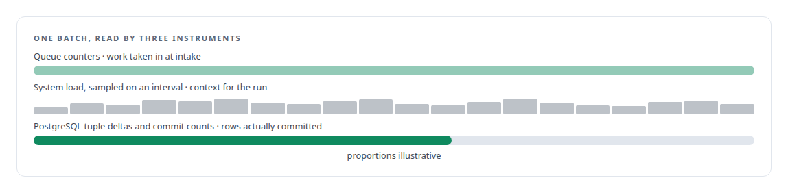
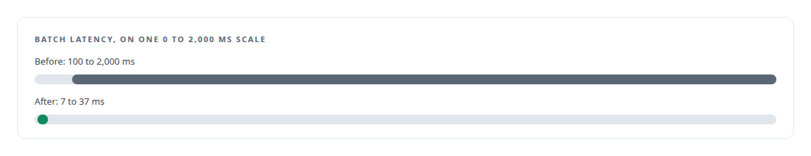

# 196 deadlocks to zero

**Measuring a write path from the database itself, and finding that one index was the whole problem**

Canonical: https://coreyjames.ai/stories/196-deadlocks-to-zero/  
Author: Corey James · Published: 2026-10-28 · Kind: story  
Systems: [FAFO Core and Function Forge](https://github.com/coreyjames-ai/fafo-core)  
Technologies: [Database performance diagnosis](https://github.com/coreyjames-ai/portfolio/tree/main/technologies/database-performance-diagnosis) · [Evidence-gated acceptance](https://github.com/coreyjames-ai/portfolio/tree/main/technologies/evidence-gated-acceptance) · [Lease-based work claiming](https://github.com/coreyjames-ai/portfolio/tree/main/technologies/lease-based-work-claiming) · [Lua](https://github.com/coreyjames-ai/portfolio/tree/main/technologies/lua) · [MessagePack](https://github.com/coreyjames-ai/portfolio/tree/main/technologies/messagepack) · [Performance engineering and benchmarking](https://github.com/coreyjames-ai/portfolio/tree/main/technologies/performance-engineering-and-benchmarking) · [PostgreSQL](https://github.com/coreyjames-ai/portfolio/tree/main/technologies/postgresql) · [PostgreSQL bulk-update engineering](https://github.com/coreyjames-ai/portfolio/tree/main/technologies/postgresql-bulk-update-engineering) · [Python](https://github.com/coreyjames-ai/portfolio/tree/main/technologies/python) · [Redis](https://github.com/coreyjames-ai/portfolio/tree/main/technologies/redis) · [Rust](https://github.com/coreyjames-ai/portfolio/tree/main/technologies/rust) · [SQL](https://github.com/coreyjames-ai/portfolio/tree/main/technologies/sql) · [Write-behind persistence](https://github.com/coreyjames-ai/portfolio/tree/main/technologies/write-behind-persistence)  
Skills: [PostgreSQL performance tuning](https://github.com/coreyjames-ai/portfolio/tree/main/skills/postgresql-performance-tuning)  


## Result

| Figure | What it measures |
| --- | --- |
| **196 → 0** | deadlocks during the run, before and after one index |
| **1.25 M** | rows committed in 185 seconds after the fix |
| **16,370** | peak rows committed a second; 6,752 on average |

## What was built

A bulk update workload through my shared write path had slowed to a crawl, with deadlocks every few seconds. The queue in front of the database reported healthy throughput, which was the first clue that the queue was the wrong instrument. I built a harness that measured from the only place that knows how many rows were committed, the database itself, and compared runs before and after a single schema change.

## The challenge

The write path is shared by every producer in the estate, so a slow write path slows everything. The obvious metrics were the queue's own counters, and they measure intake: how much work was taken in, and nothing about how much landed. A diagnosis built on intake would have optimised the wrong thing.

## Constraints

Shared infrastructure, so the write path could not be taken offline to test it. Ground truth had to be the database; anything else was a proxy.

## My approach

Sample the system, the queue and the database every few seconds during a controlled run, and treat PostgreSQL's own tuple statistics as the truth about committed work. Run the workload, change one thing, run it again, and compare the two reports.



## What I built

A benchmark harness that samples system load, queue depth and PostgreSQL tuple deltas on a fixed interval and renders a before-and-after report.

The fix, which turned out to be a unique index on the update key of the target table. The missing index was forcing the engine into lock patterns that collided under concurrent batches.

## Difficult decisions

Rejecting the queue's numbers. The queue said throughput was fine.


## Results

Bulk-updating a cluster-health metrics table on my primary host:



## Technologies used

PostgreSQL tuple statistics, index design and lock behaviour · Python benchmark tooling · Rust write-path service

## What this demonstrates

Disciplined performance diagnosis: choose the source of truth before measuring, change one thing, and let the comparison find the answer. Sometimes the answer is one index.

> Only the database knows how many rows were committed.

## What was verified

Each line is a claim the canonical page supports, with the figure as the page states it.

- PostgreSQL performance tuning: a unique index on the update key took deadlocks during a bulk update from 196 to 0 on a write path shared by every producer.
- Performance benchmarking methodology: a harness that samples system load, queue depth and PostgreSQL tuple deltas and compares runs before and after one change, measuring committed rows, not intake.
- Write-path throughput: 1.25 M rows committed in 185 seconds after the fix, 16,370 a second at peak and 6,752 on average.
- Latency diagnosis: batch latency from 100 to 2,000 ms before the index and 7 to 37 ms after it.

## Related

- [The workload that shaped the platform](https://github.com/coreyjames-ai/fafo-core/tree/main/stories/the-workload-that-shaped-the-platform) · https://coreyjames.ai/stories/the-workload-that-shaped-the-platform/
- [Millions of queued items that were not there](https://github.com/coreyjames-ai/inference-fabric/tree/main/stories/millions-of-queued-items-that-were-not-there) · https://coreyjames.ai/stories/millions-of-queued-items-that-were-not-there/

## Citation

Corey James. "196 deadlocks to zero." coreyjames.ai, 2026. https://coreyjames.ai/stories/196-deadlocks-to-zero/

```bibtex
@misc{coreyjames-196-deadlocks-to-zero,
  author = {Corey James},
  title = {196 deadlocks to zero},
  year = {2026},
  howpublished = {\url{https://coreyjames.ai/stories/196-deadlocks-to-zero/}},
  note = {GitHub copy: https://github.com/coreyjames-ai/fafo-core/tree/main/stories/196-deadlocks-to-zero}
}
```

Part of [FAFO Core and Function Forge](https://github.com/coreyjames-ai/fafo-core) and [Corey James's portfolio](https://github.com/coreyjames-ai/portfolio) · site: https://coreyjames.ai/ · MCP server: https://coreyjames.ai/mcp · agent card: https://coreyjames.ai/.well-known/agent.json
