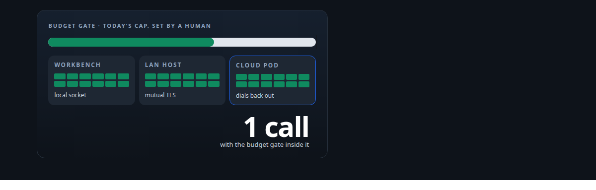
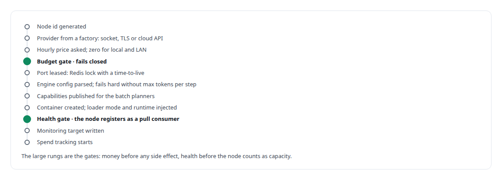
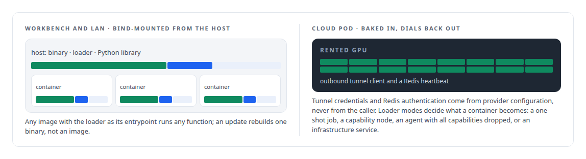
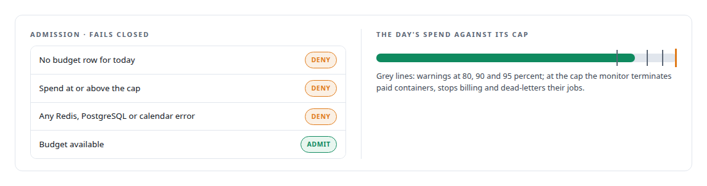
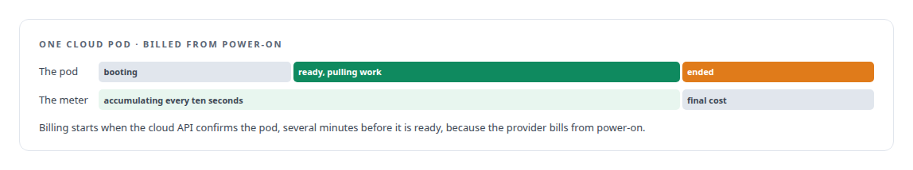

# One call to a GPU anywhere

**Provisioning a GPU consumer node on the workbench, on a LAN host or in the cloud with one tool call, under a daily budget that only a human can set**

Canonical: https://coreyjames.ai/stories/one-call-to-a-gpu-anywhere/  
Author: Corey James · Published: 2026-10-28 · Kind: story  
DOI: https://doi.org/10.5281/zenodo.23735130 (this page is a chapter of the system's report)  
Systems: [FAFO Core and Function Forge](https://github.com/coreyjames-ai/fafo-core) · [Inference Fabric](https://github.com/coreyjames-ai/inference-fabric) · [AgentOS](https://github.com/coreyjames-ai/agentos)  
Technologies: [Budget enforcement and cost governance](https://github.com/coreyjames-ai/portfolio/tree/main/technologies/budget-enforcement-and-cost-governance) · [Docker](https://github.com/coreyjames-ai/portfolio/tree/main/technologies/docker) · [Federated compute provisioning](https://github.com/coreyjames-ai/portfolio/tree/main/technologies/federated-compute-provisioning) · [PostgreSQL](https://github.com/coreyjames-ai/portfolio/tree/main/technologies/postgresql) · [Redis](https://github.com/coreyjames-ai/portfolio/tree/main/technologies/redis) · [RunPod](https://github.com/coreyjames-ai/portfolio/tree/main/technologies/runpod) · [TLS and mTLS](https://github.com/coreyjames-ai/portfolio/tree/main/technologies/tls-and-mtls)  
Skills: [zero-trust and zero-inbound networking](https://github.com/coreyjames-ai/portfolio/tree/main/skills/zero-trust-and-zero-inbound-networking) · [cost attribution for AI work](https://github.com/coreyjames-ai/portfolio/tree/main/skills/cost-attribution-for-ai-work) · [tool synthesis and governed API integration](https://github.com/coreyjames-ai/portfolio/tree/main/skills/tool-synthesis-and-governed-api-integration) · [distributed systems correctness](https://github.com/coreyjames-ai/portfolio/tree/main/skills/distributed-systems-correctness)  



## Result

| Figure | What it measures |
| --- | --- |
| **15** | actions on the one provisioning tool |
| **0** | inbound ports for a cloud pod to reach the estate |
| **30 s** | between budget checks on every container, healthy ones included |
| **$0** | the day's budget when no limit row exists |

## What was built

An agent in my estate can stand up a GPU worker with one tool call: a container image, an engine, a provider, and where it should run. The same call starts a container on my workbench over the local socket, on a LAN workstation over mutual TLS, or on a rented cloud pod that dials back into my network with no inbound ports. Before any of that happens, a budget gate checks the day's dollar cap, which is set by a human with a command-line tool that is not on any agent's tool surface. Spend is metered from the second the provider confirms the pod, and a container that outlives the budget is terminated.

## One call

The provisioning tool takes an image with an optional pinned digest, an engine directory that must carry its configuration and consumer settings, a provider, a GPU, and for a LAN target the name of a registered host. The sequence is a composition of the substrate. The tool's other actions include draining a node's queues, setting an idle timeout, onboarding and tearing down LAN hosts, syncing engines to them, and listing images and engines.



## Runtime injection

There is one runtime binary, built on the host. For local and LAN containers the provider bind-mounts the binary, a loader script as the entrypoint, and the Python shared library it links against, so any image with the loader as its entrypoint can run any function and a function update means rebuilding one binary instead of an image. Cloud pods cannot bind-mount from the host, so the cloud images bake in an outbound tunnel client and a Redis heartbeat; the pod dials back to the private network, and remote GPUs reach the estate's Redis and PostgreSQL with zero inbound ports. An image manifest lists each image's digest, CUDA version, supported GPUs and providers, and environment contract; the Blackwell base image covers consumer and datacentre Blackwell and a second image covers Ada, Hopper and Ampere.

Four loader modes decide what a container becomes.



## A LAN host in eleven steps

Onboarding a LAN machine is an eleven-step procedure with rollback: a prerequisite probe for systemd, Docker, the NVIDIA container toolkit and a passwordless-sudo user; a private certificate authority, written in-crate, issuing an ECDSA server certificate with the host's name and address in the subject alternative names and a client certificate; Docker's daemon configured for TLS; the engine synced across; and the host registered. After that the host is one more location the same call can target.

## The budget

The authority is a table of daily limits keyed by date, with an audit row for every change. A small calendar crate shared by the command-line tool and every consumer defines a budget window from local midnight to local midnight in the operator's time zone, refuses ambiguous daylight-saving midnights, and validates any published window by recomputing it, so a forged or shifted interval is refused. Budgets are per date and never carry over.

The admission rule fails closed. Local and LAN containers cost nothing and still pass through the gate, so setting the day's budget is also the operator's daily arming of all container provisioning; only in-process work skips it. The same gate runs before control-plane jobs that carry a container configuration, before every agent persona container the swarm launches, and before every media-studio start.



A ten-second loop accumulates spend per container, per schema and globally in a durable Redis, synced to PostgreSQL through the write-behind queue. A daily projection recomputes today's spend from per-container identities under a publication lock, prorating active containers inside the window and splitting a container that crosses midnight across the two days. Finalisation closes a container's spend into the day's total, a finalised identity cannot be revived by a stale writer, and lowering the day's allowance never resets spend already finalised. On restart, active containers are read back and the gap since their last sync is recomputed.



The health monitor asks the budget plane about each container on every pass. When the budget is no longer available it terminates the container through the provider and marks it exhausted. Orphaned pods the provider stopped but left billable are found and cleaned up.

## Why an agent cannot raise the budget

The only code in the estate that writes a daily limit is the human command-line tool. No tool on any gateway writes budgets; agents get read paths and refusals. The check runs inside the provisioning function before any side effect, and nothing an agent passes to the call changes the cap. Every change is audited.


## Spend you can read

Terminating a node returns its final cost to the caller. The command-line status shows today's budget and spend in the operator's time zone, the remaining amount and percentage, the paid containers currently up, with their rates, the time until exhaustion, the next seven days' budgets and recent changes. Storage costs from the provider are synced and reported separately under a soft monthly cap. Per-container rate, start, end and total cost sit in a PostgreSQL table with schema and function attribution.

Model usage inside governed work is a separate plane, attributed rather than gated: tokens are classified into uncached input, output, cache reads and cache creation, priced against a public catalog at run time and left unpriced when pricing is unavailable, and rolled up by work order, task, role, model and phase. I ruled that model cost is telemetry and strategy, and reserved hard gates for rented capacity and metered third-party APIs. The cost of one real program is in [What the work cost, to the penny](https://coreyjames.ai/stories/what-the-work-cost).

## What this demonstrates

Infrastructure that lets agents reach real hardware safely: one call across three locations, zero inbound ports, a budget a human sets and an agent cannot, and accounting that bills from power-on and survives a restart.

> Missing or invalid state can only yield zero or an error, never a larger cap.

## What was verified

Each line is a claim the canonical page supports, with the figure as the page states it.

- Cloud GPU provisioning with cost controls: one tool with 15 actions stands up a GPU worker on the workbench, a LAN host or a rented cloud pod.
- Zero-trust and zero-inbound networking: cloud pods dial back through an outbound tunnel, reaching Redis and PostgreSQL with 0 inbound ports; LAN hosts are driven over mutual TLS from a private certificate authority.
- Budget enforcement for AI agents: a daily dollar cap set only by a human command-line tool, checked before any side effect, failing closed at $0 when no limit row exists.
- Metering and reconciliation: spend accumulated per container, per schema and globally, with health checks every 30 s that terminate any container still up once the budget is spent.
- Container runtime design: one host-built runtime binary bind-mounted with a loader into any image, and four loader modes that decide what a container becomes.

## Related

- [Built for Blackwell](https://github.com/coreyjames-ai/inference-fabric/tree/main/stories/built-for-blackwell) · https://coreyjames.ai/stories/built-for-blackwell/
- [What the work cost, to the penny](https://github.com/coreyjames-ai/agentos/tree/main/stories/what-the-work-cost) · https://coreyjames.ai/stories/what-the-work-cost/
- [Tools that build tools, under governance](https://github.com/coreyjames-ai/fafo-core/tree/main/stories/tools-that-build-tools-under-governance) · https://coreyjames.ai/stories/tools-that-build-tools-under-governance/

## Citation

Corey James. "One call to a GPU anywhere." coreyjames.ai, 2026. https://coreyjames.ai/stories/one-call-to-a-gpu-anywhere/ In: the FAFO Core and Function Forge technical report, doi:10.5281/zenodo.23735130.

```bibtex
@misc{coreyjames-one-call-to-a-gpu-anywhere,
  author = {Corey James},
  title = {One call to a GPU anywhere},
  year = {2026},
  howpublished = {\url{https://coreyjames.ai/stories/one-call-to-a-gpu-anywhere/}},
  note = {GitHub copy: https://github.com/coreyjames-ai/fafo-core/tree/main/stories/one-call-to-a-gpu-anywhere},
  doi = {10.5281/zenodo.23735130}
}
```

Part of [FAFO Core and Function Forge](https://github.com/coreyjames-ai/fafo-core) and [Corey James's portfolio](https://github.com/coreyjames-ai/portfolio) · site: https://coreyjames.ai/ · MCP server: https://coreyjames.ai/mcp · agent card: https://coreyjames.ai/.well-known/agent.json
