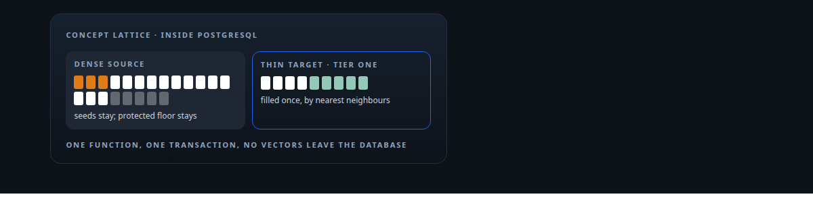
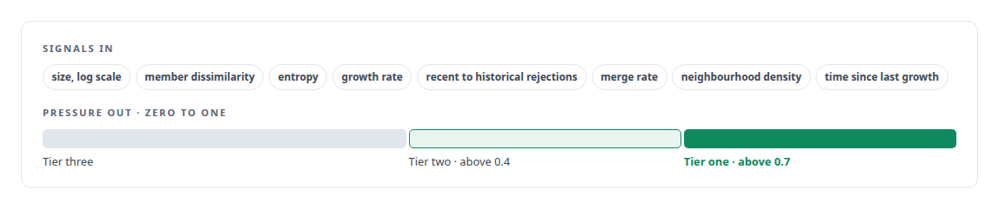
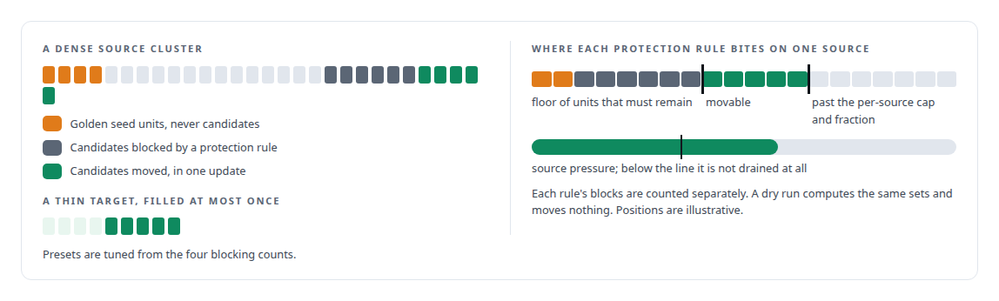

# Redistribution inside the database

**The lattice functions that grow, protect and score concept clusters over millions of vectors without leaving PostgreSQL**

Canonical: https://coreyjames.ai/stories/redistribution-inside-the-database/  
Author: Corey James · Published: 2026-10-28 · Kind: story  
DOI: https://doi.org/10.5281/zenodo.23735130 (this page is a chapter of the system's report)  
Systems: [FAFO Core and Function Forge](https://github.com/coreyjames-ai/fafo-core) · [Capabilities model](https://github.com/coreyjames-ai/capabilities-model)  
Technologies: [Hybrid retrieval](https://github.com/coreyjames-ai/portfolio/tree/main/technologies/hybrid-retrieval) · [PostgreSQL](https://github.com/coreyjames-ai/portfolio/tree/main/technologies/postgresql) · [PostgreSQL bulk-update engineering](https://github.com/coreyjames-ai/portfolio/tree/main/technologies/postgresql-bulk-update-engineering) · [Rust](https://github.com/coreyjames-ai/portfolio/tree/main/technologies/rust) · [SQL](https://github.com/coreyjames-ai/portfolio/tree/main/technologies/sql) · [pgvector](https://github.com/coreyjames-ai/portfolio/tree/main/technologies/pgvector)  
Skills: [vector search and ANN indexes](https://github.com/coreyjames-ai/portfolio/tree/main/skills/vector-search-and-ann-indexes) · [embedding analytics and cluster metrics](https://github.com/coreyjames-ai/portfolio/tree/main/skills/embedding-analytics-and-cluster-metrics) · [Rust systems engineering](https://github.com/coreyjames-ai/portfolio/tree/main/skills/rust-systems-engineering) · [evidence-gated acceptance](https://github.com/coreyjames-ai/portfolio/tree/main/skills/evidence-gated-acceptance)  



## Result

| Figure | What it measures |
| --- | --- |
| **1,024** | dimensions in every unit's embedding |
| **8** | signals weighted into each cluster's pressure |
| **~11,000** | lines of Rust in the sole acceptance authority for new clusters |

## What was built

My distillation corpus is a lattice: question-and-answer units, each with a 1,024-dimension embedding, grouped into concept clusters with a centroid, a tier and a pressure score. The lattice has to grow where it is thin, stay stable where it is dense, admit new clusters only on evidence, and never let its seed units move. I built those behaviours as functions that run inside PostgreSQL, because the work is a set of index-backed nearest-neighbour queries and one atomic update, and moving millions of vectors to an application server would cost more than the work itself.

## Pressure

Every cluster carries a saturation pressure between zero and one, higher meaning more need to grow. It is a weighted sum of signals about the cluster's size, spread, history and neighbourhood. Missing signals default to the midpoint, and updates are queued and applied in batches.



## Redistribution

One database function runs a whole schema as a single transaction. It selects targets: active clusters with a centroid, pressure above a threshold, an eligible tier, and no prior fill event. A cluster is filled at most once, which stops runs from oscillating units back and forth. For each target it runs a lateral nearest-neighbour query over units in other clusters, ordered by cosine distance to the centroid through an inverted-file index, limited to a candidate count and filtered by a similarity threshold. Golden seed units are excluded and never move. The lateral join is chosen so each centroid's search uses the index instead of a cross product.

Candidates are then ranked within their source cluster and blocked by four protection rules, each counted separately. The move is one update that re-parents the allowed units, and history rows log the fill on each target and the drain on each source with counts and a run id. The function returns clusters processed, units moved, candidates found and blocked, and the four blocking counts.



A reverse mode works from the other side: units in high-pressure sources each find their single best centroid among eligible targets, under the same thresholds and protections. Three presets, conservative, balanced and aggressive, set the similarity and pressure thresholds, the candidate limit and the four protections.

## Admission of new clusters

A candidate cluster, synthesised from a group of generated question-and-answer pairs, is scored deterministically, and every failed test comes back as a reason. This replaced a Python gatekeeper and is the pipeline's sole acceptance authority for new clusters.


## Health

Cluster health is measured in three tiers of metrics. These feed the pressure model's inputs, and the GPU re-implementation of the same statistics is the engine in [Thirty-eight metrics in a dozen passes](https://coreyjames.ai/stories/thirty-eight-metrics-in-a-dozen-passes).


## What this demonstrates

Data-locality judgment: when the algorithm is nearest-neighbour queries and one atomic update, the database is the right engine, and making the protection rules first-class and their effects countable is what makes the system tunable.


> Fill once, protect seeds, keep history, and the lattice converges instead of churning.

## What was verified

Each line is a claim the canonical page supports, with the figure as the page states it.

- In-database computation with PostgreSQL and pgvector: lattice functions that grow, protect and score concept clusters over millions of vectors of 1,024 dimensions without leaving the database.
- Vector search and ANN indexes: lateral nearest-neighbour queries through an inverted-file index, so each centroid search uses the index instead of a cross product.
- Transactional data redistribution: one function runs a whole schema as a single transaction, moves units in one update, and logs fills and drains with counts and a run id.
- Deterministic acceptance scoring: ~11,000 lines of Rust as the sole acceptance authority for new clusters, every failed test returned as a reason.
- Tunable data-quality models: cluster pressure from 8 weighted signals, four protection rules counted separately, and three presets from conservative to aggressive.

## Related

- [The workload that shaped the platform](https://github.com/coreyjames-ai/fafo-core/tree/main/stories/the-workload-that-shaped-the-platform) · https://coreyjames.ai/stories/the-workload-that-shaped-the-platform/
- [Thirty-eight metrics in a dozen passes](https://github.com/coreyjames-ai/inference-fabric/tree/main/stories/thirty-eight-metrics-in-a-dozen-passes) · https://coreyjames.ai/stories/thirty-eight-metrics-in-a-dozen-passes/

## Citation

Corey James. "Redistribution inside the database." coreyjames.ai, 2026. https://coreyjames.ai/stories/redistribution-inside-the-database/ In: the FAFO Core and Function Forge technical report, doi:10.5281/zenodo.23735130.

```bibtex
@misc{coreyjames-redistribution-inside-the-database,
  author = {Corey James},
  title = {Redistribution inside the database},
  year = {2026},
  howpublished = {\url{https://coreyjames.ai/stories/redistribution-inside-the-database/}},
  note = {GitHub copy: https://github.com/coreyjames-ai/fafo-core/tree/main/stories/redistribution-inside-the-database},
  doi = {10.5281/zenodo.23735130}
}
```

Part of [FAFO Core and Function Forge](https://github.com/coreyjames-ai/fafo-core) and [Corey James's portfolio](https://github.com/coreyjames-ai/portfolio) · site: https://coreyjames.ai/ · MCP server: https://coreyjames.ai/mcp · agent card: https://coreyjames.ai/.well-known/agent.json
