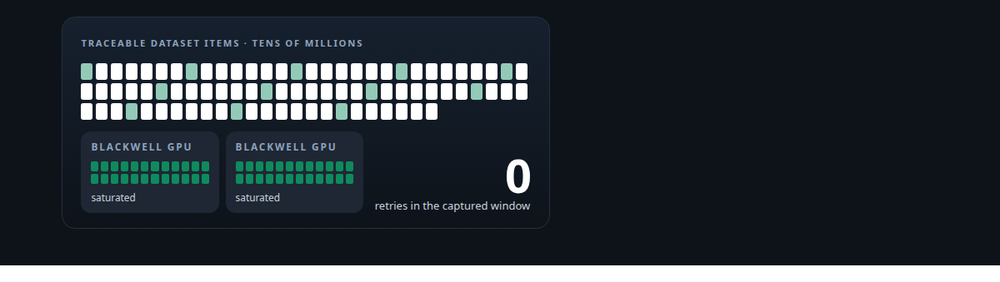
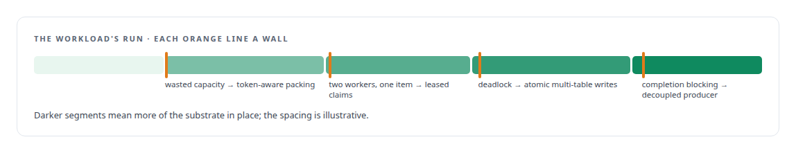
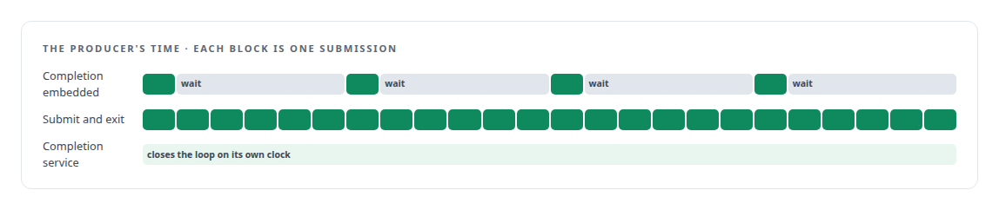
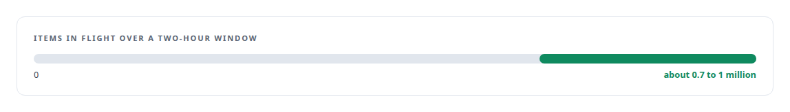

# The workload that shaped the platform

**Generating tens of millions of traceable dataset items on two consumer GPUs, and letting that job decide what the substrate needed**

Canonical: https://coreyjames.ai/stories/the-workload-that-shaped-the-platform/  
Author: Corey James · Published: 2026-10-28 · Kind: story  
Systems: [FAFO Core and Function Forge](https://github.com/coreyjames-ai/fafo-core) · [Inference Fabric](https://github.com/coreyjames-ai/inference-fabric)  
Technologies: [Distributed job orchestration](https://github.com/coreyjames-ai/portfolio/tree/main/technologies/distributed-job-orchestration) · [Grafana](https://github.com/coreyjames-ai/portfolio/tree/main/technologies/grafana) · [Hidden-state extraction](https://github.com/coreyjames-ai/portfolio/tree/main/technologies/hidden-state-extraction) · [Large-scale GPU data pipelines](https://github.com/coreyjames-ai/portfolio/tree/main/technologies/large-scale-gpu-data-pipelines) · [Lease-based work claiming](https://github.com/coreyjames-ai/portfolio/tree/main/technologies/lease-based-work-claiming) · [Lua](https://github.com/coreyjames-ai/portfolio/tree/main/technologies/lua) · [Model families and types](https://github.com/coreyjames-ai/portfolio/tree/main/technologies/model-families-and-types) · [NVIDIA Blackwell GPUs](https://github.com/coreyjames-ai/portfolio/tree/main/technologies/nvidia-blackwell-gpus) · [NVIDIA TensorRT-LLM](https://github.com/coreyjames-ai/portfolio/tree/main/technologies/nvidia-tensorrt-llm) · [PostgreSQL](https://github.com/coreyjames-ai/portfolio/tree/main/technologies/postgresql) · [Redis](https://github.com/coreyjames-ai/portfolio/tree/main/technologies/redis) · [Rust](https://github.com/coreyjames-ai/portfolio/tree/main/technologies/rust) · [Synthetic training-data generation](https://github.com/coreyjames-ai/portfolio/tree/main/technologies/synthetic-training-data-generation) · [Token-aware GPU batch scheduling](https://github.com/coreyjames-ai/portfolio/tree/main/technologies/token-aware-gpu-batch-scheduling)  
Skills: [exactly-once delivery and crash recovery](https://github.com/coreyjames-ai/portfolio/tree/main/skills/exactly-once-delivery-and-crash-recovery) · [high-throughput batch inference](https://github.com/coreyjames-ai/portfolio/tree/main/skills/high-throughput-batch-inference) · [token-aware scheduling](https://github.com/coreyjames-ai/portfolio/tree/main/skills/token-aware-scheduling) · [inference serving architecture](https://github.com/coreyjames-ai/portfolio/tree/main/skills/inference-serving-architecture)  



## Result

| Figure | What it measures |
| --- | --- |
| **876K** | probes submitted in one captured window |
| **131 M** | tokens pending in the same window, with zero retries |
| **156/s** | probes per second through that window |

## What was built

My distillation research needed tens of millions of model-generated dataset items, each traceable back to the knowledge it was drawn from, produced fast enough to keep two GPUs saturated.


## The challenge

Dataset construction at this scale is an industrial data pipeline. Every item needs a persistent identity so a crash does not lose it or run it twice. Writes span several tables and must stay referentially consistent. Prompts have to be shaped so the inference engine can reuse cached work across millions of near-identical requests. And none of it may wait on anything else.

## Constraints

Two consumer GPUs. Nothing waits: a slow writer must not stall generation, and a busy GPU must not stall producers. Foreign-key-safe writes across multiple tables under heavy concurrency. Crash safety, so work is neither lost nor duplicated across a restart of any component.

## My approach

Let the real workload drive the substrate. Each time the pipeline hit a wall I added the one capability the wall demanded. Nothing speculative went in. What came out was a general execution substrate shaped by a job that ran.



## What I built

A probe-generation library with explicit input and output contracts and reviewed phases, and the function that runs it on the substrate.

Token-aware packing, so each batch submitted to the GPU broker carries similar shapes and minimal padding.

Lease-based claiming of work items, so parallel workers do not process the same item.

Multi-table atomic writes that keep the result tables consistent under load.

A decoupled submit-and-exit producer. Generation requests go to the GPU broker and the producer moves on; a separate completion service closes the loop. Two earlier attempts at embedding completion in the producer are kept as the iteration history.

A build step that moves a runtime dependency into the binary.

Recovery of buffered items after a broker loss, so in-flight work survived an infrastructure failure.

## Difficult decisions

Moving a runtime dependency into the build. It made the binary depend on a build step, and it was what made cache reuse dependable.

Decoupling completion. The embedded design was simpler to explain. It also made the producer wait on results. 



## Results



After an infrastructure failure, a large backlog of buffered items was recovered instead of regenerated.

## Technologies used

Rust · PostgreSQL · Redis · TensorRT-LLM · Grafana · Large-scale dataset construction with provenance · NVIDIA Blackwell GPUs

## What this demonstrates

I build platforms from workloads. The substrate under my later systems has the shape it has because a real job of tens of millions of items ran on two consumer GPUs and told me what was missing.

> I did not design a platform and then look for a workload. I ran the workload and built exactly what it forced.

## What was verified

Each line is a claim the canonical page supports, with the figure as the page states it.

- High-throughput batch inference: a dataset pipeline that kept two consumer GPUs saturated, with 876K probes submitted in one captured window at 156/s.
- Token-aware scheduling: shape-similar batches with minimal padding, 131 M tokens pending in the same window with zero retries.
- Exactly-once delivery and crash recovery: lease-based claiming, multi-table atomic writes and recovery of buffered items after a broker loss, so work was neither lost nor run twice.
- Data pipeline engineering with provenance: tens of millions of model-generated dataset items, each traceable to the knowledge it was drawn from.
- Platform design from workloads: each wall the pipeline hit added the one capability it forced, including a decoupled submit-and-exit producer with a separate completion service.

## Related

- [A message broker that understands tokens](https://github.com/coreyjames-ai/inference-fabric/tree/main/stories/a-message-broker-that-understands-tokens) · https://coreyjames.ai/stories/a-message-broker-that-understands-tokens/
- [Millions of queued items that were not there](https://github.com/coreyjames-ai/inference-fabric/tree/main/stories/millions-of-queued-items-that-were-not-there) · https://coreyjames.ai/stories/millions-of-queued-items-that-were-not-there/
- [From 44K to 163K tokens per second](https://github.com/coreyjames-ai/inference-fabric/tree/main/stories/from-44k-to-163k-tokens-per-second) · https://coreyjames.ai/stories/from-44k-to-163k-tokens-per-second/

## Citation

Corey James. "The workload that shaped the platform." coreyjames.ai, 2026. https://coreyjames.ai/stories/the-workload-that-shaped-the-platform/

```bibtex
@misc{coreyjames-the-workload-that-shaped-the-platform,
  author = {Corey James},
  title = {The workload that shaped the platform},
  year = {2026},
  howpublished = {\url{https://coreyjames.ai/stories/the-workload-that-shaped-the-platform/}},
  note = {GitHub copy: https://github.com/coreyjames-ai/fafo-core/tree/main/stories/the-workload-that-shaped-the-platform}
}
```

Part of [FAFO Core and Function Forge](https://github.com/coreyjames-ai/fafo-core) and [Corey James's portfolio](https://github.com/coreyjames-ai/portfolio) · site: https://coreyjames.ai/ · MCP server: https://coreyjames.ai/mcp · agent card: https://coreyjames.ai/.well-known/agent.json
