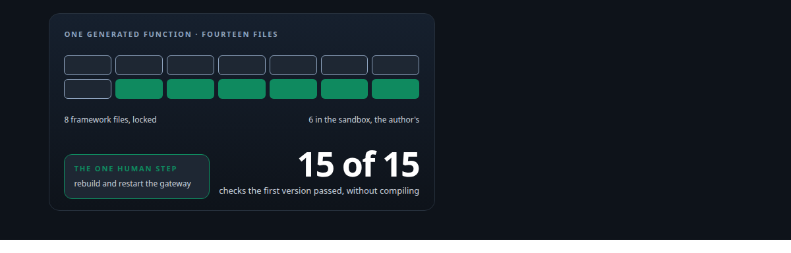
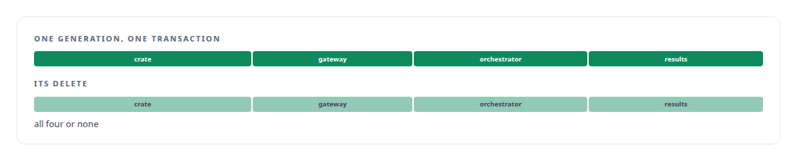
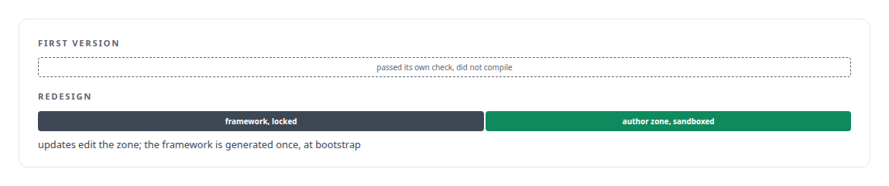

# Tools that build tools, under governance

**A generator that lets agents add new capabilities to the estate, inside a sandbox, callable only after a human restart**

Canonical: https://coreyjames.ai/stories/tools-that-build-tools-under-governance/  
Author: Corey James · Published: 2026-10-28 · Kind: story  
Systems: [FAFO Core and Function Forge](https://github.com/coreyjames-ai/fafo-core)  
Technologies: [Agent tool-execution safety and sandboxing](https://github.com/coreyjames-ai/portfolio/tree/main/technologies/agent-tool-execution-safety-and-sandboxing) · [Axum](https://github.com/coreyjames-ai/portfolio/tree/main/technologies/axum) · [Code generation and metaprogramming](https://github.com/coreyjames-ai/portfolio/tree/main/technologies/code-generation-and-metaprogramming) · [Evidence-gated acceptance](https://github.com/coreyjames-ai/portfolio/tree/main/technologies/evidence-gated-acceptance) · [Handlebars](https://github.com/coreyjames-ai/portfolio/tree/main/technologies/handlebars) · [JSON-RPC](https://github.com/coreyjames-ai/portfolio/tree/main/technologies/json-rpc) · [Link-time plugin registration](https://github.com/coreyjames-ai/portfolio/tree/main/technologies/link-time-plugin-registration) · [Model Context Protocol (MCP)](https://github.com/coreyjames-ai/portfolio/tree/main/technologies/model-context-protocol-mcp) · [PostgreSQL](https://github.com/coreyjames-ai/portfolio/tree/main/technologies/postgresql) · [Python](https://github.com/coreyjames-ai/portfolio/tree/main/technologies/python) · [Reversible infrastructure mutation](https://github.com/coreyjames-ai/portfolio/tree/main/technologies/reversible-infrastructure-mutation) · [Rust](https://github.com/coreyjames-ai/portfolio/tree/main/technologies/rust) · [Schema-agnostic data access and SQL-injection defence](https://github.com/coreyjames-ai/portfolio/tree/main/technologies/schema-agnostic-data-access-and-sql-injection-defence) · [Schema-driven build-time code generation](https://github.com/coreyjames-ai/portfolio/tree/main/technologies/schema-driven-build-time-code-generation) · [YAML](https://github.com/coreyjames-ai/portfolio/tree/main/technologies/yaml) · [sqlx](https://github.com/coreyjames-ai/portfolio/tree/main/technologies/sqlx)  
Skills: [tool synthesis and governed API integration](https://github.com/coreyjames-ai/portfolio/tree/main/skills/tool-synthesis-and-governed-api-integration) · [AI-assisted engineering methodology](https://github.com/coreyjames-ai/portfolio/tree/main/skills/ai-assisted-engineering-methodology) · [sandboxing and container hardening](https://github.com/coreyjames-ai/portfolio/tree/main/skills/sandboxing-and-container-hardening) · [Rust systems engineering](https://github.com/coreyjames-ai/portfolio/tree/main/skills/rust-systems-engineering)  



## Result

| Figure | What it measures |
| --- | --- |
| **7 of 14** | function crates in the estate carry the generator's fingerprints |
| **14 files** | per function: eight framework, six sandboxed |
| **4** | places written in one rollback-protected transaction per generation |

## What was built

My agents could call tools and could not add one. Every new capability meant a human wiring a crate into the gateway, the orchestrator and the result path by hand. I built a generator, exposed as a tool, that lets an agent author a new function for the estate. The generated code runs in a sandbox that sees only a capability-bounded context, cannot open its own connections or write the database directly, and runs only after a human rebuilds and restarts the gateway.

## The challenge

AI-written processing code, given a database handle, will build unsafe queries, write tables it should not, and open connections nobody audits. And a tool that is half-registered, present in the gateway and absent from the result path, shows up as a hang. The generator had to make adding a capability cheap for an agent while making it impossible for that capability to bypass the rules the rest of the estate lives under.


## Constraints

Nothing runs without a human. Data-safety rules apply to generated code exactly as to hand-written code. Clean removal, so deleting a generated function is as thorough as creating it. No gateway restart from inside a call, because the restart would cut off the agent that asked for it.

## My approach

Treat AI agents as bounded authors. The generator is itself an MCP tool. What it produces is split: framework files the author must not modify, and a developer zone where the author writes logic against a context object, never against raw resources. The human gate sits exactly at the privileged step, the rebuild and restart, and nowhere else.

## What I built

A Rust generator that emits the function and edits the services it touches in one rollback-protected transaction. A symmetric delete reverses all of it.



Link-time registration, so a function is fully wired or the build fails. There is no half-registered state.

A compiled-in authoring guide that travels with the generated code.

The sandbox boundary: reads go through a schema resolver that validates every identifier, writes go only through the governed queue, raw connection pools are excluded, and the escalation path for anything the context does not offer is a filed enhancement request.

## Difficult decisions

Redesigning after a self-audit. The first version passed its own fifteen-point integration check and generated code that did not compile. I redesigned it with the sandbox and inverted ownership instead of patching it.



No hot-loading. Rebuild and human restart is slower than hot-loading a new function. It is the governance step, and I kept it.

Bootstrap only, because an update would overwrite the developer zone.

Stubs over shortcuts. Some context features, such as vector search, were left as stubs instead of being wired through an unsafe path.

## Results

The generated crates include mining, swarm management, the persona launcher and vector-store management.

## Technologies used

Rust · Handlebars templates · Model Context Protocol and JSON-RPC · Link-time registration · YAML schema compilation · PostgreSQL · Transactional multi-service edits

## What this demonstrates

Self-extending AI systems that stay operable and safe, with security achieved by API design, and the willingness to throw away a first version that passed its own tests.

> Self-extending systems are where safety usually goes to die.

## What was verified

Each line is a claim the canonical page supports, with the figure as the page states it.

- Tool synthesis and governed API integration: a generator, itself an MCP tool, that lets an AI agent author a new function, with 7 of 14 function crates in the estate carrying its fingerprints.
- Sandboxing generated code: 14 files per function, eight framework files locked and six in a sandbox that reads through a schema resolver and writes only through the governed queue.
- Transactional code generation: 4 places written in one rollback-protected transaction per generation, with a symmetric delete and link-time registration so nothing is half-registered.
- Human-in-the-loop control for AI agents: a generated function runs only after a human rebuilds and restarts the gateway.
- Self-audit and redesign: a first version that passed its own fifteen-point check but generated code that did not compile, rebuilt with inverted ownership instead of patched.

## Related

- [Tools are the platform](https://github.com/coreyjames-ai/agent-swarm/tree/main/stories/tools-are-the-platform) · https://coreyjames.ai/stories/tools-are-the-platform/
- [Why long agent runs fail](https://github.com/coreyjames-ai/agentos/tree/main/stories/why-long-agent-runs-fail) · https://coreyjames.ai/stories/why-long-agent-runs-fail/

## Citation

Corey James. "Tools that build tools, under governance." coreyjames.ai, 2026. https://coreyjames.ai/stories/tools-that-build-tools-under-governance/

```bibtex
@misc{coreyjames-tools-that-build-tools-under-governance,
  author = {Corey James},
  title = {Tools that build tools, under governance},
  year = {2026},
  howpublished = {\url{https://coreyjames.ai/stories/tools-that-build-tools-under-governance/}},
  note = {GitHub copy: https://github.com/coreyjames-ai/fafo-core/tree/main/stories/tools-that-build-tools-under-governance}
}
```

Part of [FAFO Core and Function Forge](https://github.com/coreyjames-ai/fafo-core) and [Corey James's portfolio](https://github.com/coreyjames-ai/portfolio) · site: https://coreyjames.ai/ · MCP server: https://coreyjames.ai/mcp · agent card: https://coreyjames.ai/.well-known/agent.json
